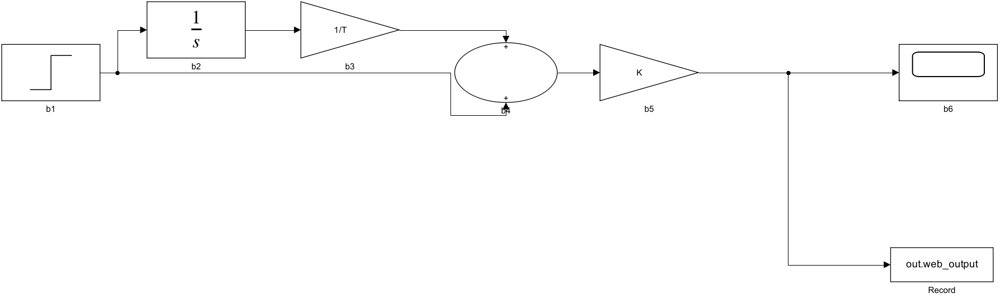

# Control Lab · 自动控制在线实验

六章共 38 个数值模型入口，包含完整展开的原理推导、原理图、可编辑代码和实验清单。**2.3 版可在网页直接运行信号框图和元件电路**，无需服务器或本机 MATLAB。原生 MATLAB / Simulink / Simscape 使用学校许可跳转到官方 Online；代码页的默认示例与实际仿真结果分别标记。

**公网地址：[打开 Control Lab](https://yky666.github.io/automation_control_online_experiments/)**。GitHub Pages 已发布，可直接分享给同学使用。[备用镜像](https://control-lab-yky666.craftychord64.chatgpt.site/)与[托管记录](docs/HOSTING.md)。

[](https://matlab.mathworks.com/open/github/v1?repo=yky666/automation_control_online_experiments&file=matlab/online/lab1_tf1.m)

## 内容覆盖与模块编辑

此前版本没有完整覆盖课件中的搭建操作。本次按六章课件逐项核查，详见 [覆盖核查记录](docs/实验一至六覆盖核查.md)。新增第一章积分器反馈、模型转换与连接，以及第三章例 2、例 3 独立入口。第二章提供 R/C→K/T，第四章保留积分、惯性与反馈组合，第六章分开校正器、对象和补偿放大器。

“元件电路仿真”页提供实验二六种环节、实验四稳定性电路、实验五频率电路和实验六有源/无源超前网络。可插入、删除 R、C、运放、电压源和受控电压源，改变元件值与端子节点，运行后查看输入/输出及内部节点波形，导出 CSV/JSON 并生成本次 HTML 报告。电路由节点方程实际求解，不从默认传递函数取曲线。有限运放模式包含单主极点带宽和输出限幅；模型假设与极性详见 [元件仿真说明](docs/元件电路仿真.md)。

信号画布也可直接运行，覆盖 37 个适定模型的线性模块组合；非真有理代数任务仍只做代数分析。完整的官方元件库仍由 Simulink / Simscape Online 提供，本网站不是官方编辑器的嵌入版本。

## 信号框图记录完善

浏览器运行会采集画布上**所有 Scope 的全部输入端口**。单个 Scope 沿用
`Scope 1` 等名称，多个 Scope 使用“模块 ID / 端口”区分。结果区可选择通道，
HTML 报告展示当前选择的曲线和全部通道的最小值、最大值、末值；末值不等同于稳态值。

导出的信号 CSV 保留前三列 `time,input,output`，随后追加全部 Scope 通道与
`source <模块 ID>` 激励源列。`output` 是第一个 Scope 的第一个端口，`input`
是画布上第一个激励源的实际输出（包括编辑后的幅值、相位、阶跃时刻），不再用
任务默认输入替代。多个激励源分别保存，无外部激励时 input 为零参考线。
这些列可用标准 CSV 阅读器读取；电路页的三列 CSV 导入仍只接受电路数据。

浏览器会检查编辑后正弦源的每周期采样数（至少 60 点），目前仅支持
`SampleTime=0` 的连续正弦源和名为 `web_input` 的工作区输入。
无效或非有限的传递函数系数会在求解前报错。
以上记录增强适用于浏览器信号仿真；原生 Simulink 导出的 Record 仍记录主输出。

## 学生使用

1. 默认浏览六章内容、默认参数的预计算结果和示例报告，无需 Online 许可。
2. 修改任务参数、传递函数、输入信号或采样设置，MATLAB 代码随之更新。图表仍为默认示例，不代表修改后的代码已执行。
3. 点击“元件电路仿真”，选择元件修改数值和端子节点，再点击 **运行当前电路**；同名节点即实际导线。右侧任务参数变化后，可点击“按当前任务参数重建”转换成新电路。电路自己的设置独立保存，避免覆盖手动搭建内容。
4. 实验一、三在“Simulink 仿真”页插块、连线，点击 **运行当前信号框图**，在该画布内查看本次结果。无需 Online 权限也可使用这两个浏览器求解器；自由 MATLAB 代码需下载或进入官方环境运行。
5. 有 Online 权限时勾选许可选项；信号模型需要 Simulink，元件电路还需要 Simscape。使用 Foundation 电气元件，未要求额外的 Simscape Electrical。官方负责登录及实际权限验证。
6. 仓库文件是默认工况。当前画布脚本会复制到剪贴板，需在 Online 粘贴后点击 **Run**，生成可继续编辑的 `.slx` 和 `time,input,output` CSV。CSV 可导回电路页绘图并生成报告；不会跨站自动读取个人会话。
7. 运行结果旁可导出本次 CSV、完整 JSON、填写个人分析并生成 HTML 报告（浏览器打印可存 PDF）。修改后会标记结果已过期，报告始终使用上次运行时的参数快照。上方“示例报告”只用于理论和格式参考。

网页不会自动读取 MathWorks 账户、许可证或个人运行结果。勾选许可是用户的使用方式选择，并非本网页已经验证许可证。[官方 GitHub 跳转说明](https://www.mathworks.com/help/matlab/matlab_env/open-github-repositories-in-matlab-online.html)说明链接打开文件的行为；[Online 版本说明](https://www.mathworks.com/products/matlab-online/matlab-online-versions.html)说明许可版和基本版。MathWorks 也提供有时间限制的基本版，因此不能把未关联学校许可直接等同于官方禁止访问。

## 无服务器发布

GitHub Pages 正式地址：[Control Lab 在线实验](https://yky666.github.io/automation_control_online_experiments/)。已于 2026-10-21 发布，并验证匿名访问首页、课程数据、示例报告和模型下载正常。访客只需浏览器，不需要下载仓库、启动本机服务或安装 MATLAB。

仓库 Pages 的 Source 已设为 **GitHub Actions**。工作流 `.github/workflows/pages.yml` 在每次推送 `main` 时自动测试、构建并发布，也可在 **Actions → Publish static course website → Run workflow** 手动发布。

工作流生成匿名默认示例、课程资源和实际验证过的模型，以仓库子路径构建，并检查全部章节、资料、示例报告、模型下载和仿真 Worker 资源是否齐全。浏览器仿真在 Web Worker 内计算；页面不调用 Python API，也不需要学生访问 localhost。MathWorks 原生运行仍由访客自己的许可授权。

## 本机开发

Windows 一键安装与启动：

```powershell
powershell -ExecutionPolicy Bypass -File .\setup.ps1
powershell -ExecutionPolicy Bypass -File .\start.ps1 -OpenBrowser
```

已有环境可重新导出和构建：

```powershell
.venv\Scripts\python.exe tools\export_online.py
node tools\export_scripts.mjs
node tools\export_physical.mjs
npm.cmd run build
```

浏览器访问 `http://127.0.0.1:8765`，更新后按 **Ctrl+F5**。也可双击“重启实验网页.cmd”。

跨平台需 Python 3.12、Node 24；安装 `requirements-cloud.txt` 和 npm 依赖后执行 `npm run export:online`、`npm run build`。静态文件在 `dist/`，可托管到任何支持 HTTPS 的静态服务。

## 实验与代码

| 章节 | 内容 | MATLAB Online 默认任务 |
| --- | --- | --- |
| 1 | 数学模型与传递函数 | [四阶传递函数](https://matlab.mathworks.com/open/github/v1?repo=yky666/automation_control_online_experiments&file=matlab/online/lab1_tf1.m) |
| 2 | 典型环节模拟 | [比例环节](https://matlab.mathworks.com/open/github/v1?repo=yky666/automation_control_online_experiments&file=matlab/online/lab2_p.m) |
| 3 | 时域性能分析与设计 | [二阶系统](https://matlab.mathworks.com/open/github/v1?repo=yky666/automation_control_online_experiments&file=matlab/online/lab3_second.m) |
| 4 | 控制系统稳定性分析 | [三阶系统](https://matlab.mathworks.com/open/github/v1?repo=yky666/automation_control_online_experiments&file=matlab/online/lab4_stability1.m) |
| 5 | 频率特性测试与验证 | [惯性环节](https://matlab.mathworks.com/open/github/v1?repo=yky666/automation_control_online_experiments&file=matlab/online/lab5_frequency_inertia.m) |
| 6 | 频域法串联超前校正 | [单级超前校正](https://matlab.mathworks.com/open/github/v1?repo=yky666/automation_control_online_experiments&file=matlab/online/lab6_lead1.m) |

`matlab/online/` 有 76 份参数脚本：每个任务一份 MATLAB 脚本和一份 Simulink 建模脚本。默认曲线由 SciPy 预计算，并明确标注来源。部分分式的非真有理式只做代数与频率分析；D/PD 的课程画布则用真实 Derivative 模块，另外保留滤波对照通道，不能以理想阶跃的离散尖峰当物理峰值。

`matlab/models/` 有 **37 个经 Simulink R2024b 实际构建并运行的 `.slx`**，可从网页直接下载，或在许可允许时点击“直接打开原生模型编辑器”。这些是默认工况；当前画布修改需用“导出当前画布”或“复制画布”入口。一个非真有理代数任务不生成不适定的 Transfer Fcn 模型。

模块变量保存在模型工作区中。双击块可把表达式改成常数；需改变 K、T 等变量时，可在 Simulink 的 Model Explorer → Model Workspace 编辑。六个代表模型已从文件重新加载并仿真，验证不依赖基础工作区残留。全套 `.slx` 的信号模块仿真需要 Simulink；运行自动设计的 MATLAB 脚本还需要 Control System Toolbox。

原生 PI 模型实例（实际 Simulink 导出）：



`matlab/physical/` 提供 18 份真实电气建模脚本/模型（17 个课件任务加有限运放限幅验证）。当前编辑电路导出的脚本按实际端子生成 Simscape 元件和连线，不把电路替换为一个 Transfer Fcn。两个域的端口通过受控源和转换器连接，电容、运放仍为电气端子元件。

`frontend/` 是 React 工作台；`backend/` 保留 SciPy 计算和可选教师工作节点。默认界面使用静态资源及浏览器求解；没有共享云端 MATLAB 后台。[云端扩展说明](docs/CLOUD.md)描述服务端原生计算条件。

不提交 `.venv`、`node_modules`、运行记录、个人报告、令牌或 Simulink 缓存。课程中已有的个人实验报告也不进入公开静态资源。

## 验证

```powershell
npm.cmd test
.venv\Scripts\python.exe -m pytest tests\test_lab.py tests\test_cloud.py tests\test_online.py -q
npm.cmd run build
```

前端测试覆盖全部任务切换、许可选择、默认示例与当前脚本区分、MATLAB/Simulink 官方跳转和既有平台回归。DOM 测试不代表自动登录学校账户或真实浏览器截图验收。原有本机 MATLAB/Simulink 检查也不代表已接通云端后台。
