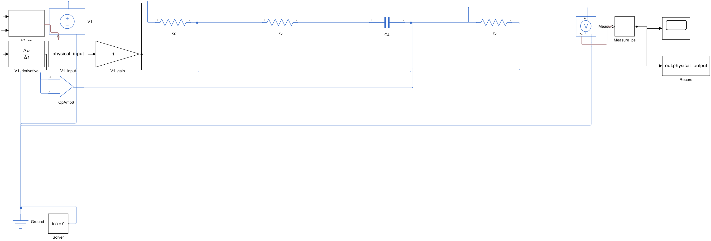

# 元件电路与实际求解

2.3 版增加两个互相独立的浏览器求解器。信号画布按 Gain、Sum、Integrator、Derivative、Transfer Fcn 等实际连接建立状态方程；元件页按电气端子网表建立改进节点方程（MNA）。运算放在 Web Worker，切换章节时终止对应工作线程。两者都不是加载另一份预计算示例，也不是在浏览器执行 MATLAB。

## 课件对应电路

| 章节 | 实际元件与连接 | 需要注意 |
| --- | --- | --- |
| 二 | P、R2∥C 惯性、电容反馈积分、输入电容微分、R2+C 串联反馈 PI、R1∥C 输入 PD | 反相负号保留，PD 的 T=R1C。正增益需实际加第二反相器。|
| 四 | 积分、两个 RC 惯性、可调比例级、反馈反相器，共五个运放 | 原图下方反馈反相器不可省略。降阶模板把第二惯性改为单位反相器以保持反馈符号。|
| 五 | 两级反相放大、反相 RC 惯性、三运放反馈二阶电路 | 三运放原图输出为 −500/(s²+10s+500)，与正归一化模型有 180° 差异。有限模式可观察带宽和限幅。|
| 六 | R1、R2、R3、C 有源超前；两级 R1∥C、R2 对地无源超前；电阻放大补偿、RC 被控对象和单位比较器 | 默认加入级间缓冲运放，避免无源级相互加载。可以删除并重新接线研究加载。主动网络加真实反相器补偿极性。|
| 一、三 | 课件对应信号模型，使用信号画布运行和原生 Simulink | 不为数学任务杜撰物理电路；非真有理部分分式任务不模拟。|

实验六的对象由积分与 RC 惯性电路实现相同的理想动态，比较点由受控电压源实现差分。它是教学模拟电路实现，并非课件未给出的真实机械对象。高频有源例题默认观察 0.2 s，以解析较快的动态。

## 求解与模型假设

电阻采用 `i=(Vp−Vn)/R`，电容采用 `i=C·d(Vp−Vn)/dt`，各电气节点满足 KCL。理想运放约束 `V+=V−`、两输入电流为零。有限运放采用 `τ·dVo/dt+Vo=A0(V+−V−)`，其中 `τ=A0/(2πGBW)`，限制状态在 ±rail；没有输入偏置电流、压摆率、噪声、真实电源脚和晶体管模型。不同型号运放需在原生库中替换，不能将教学参数当作芯片实测数据。

浏览器使用隐式欧拉和带选主元的 LU，电容初值为零；有限模式通过限幅活动集求解。奇异矩阵、悬空端子、过少正弦采样或发散会明确报错，不回退成静态示例。每次运行保留元件/接线/参数快照；修改后曲线标记为上次结果。

信号求解器使用可解析的算术表达式，不使用 `eval`；不支持的语句或变量会报错。传递函数需为最高 12 阶的真有理式。反馈通过同时求解处理，奇异代数环会报错。

隐式欧拉有数值阻尼，尤其接近临界稳定和高频时，应加密采样检查收敛。理想微分作用于阶跃有分布意义的冲激，有限离散尖峰不是物理峰值。默认电压源阶跃含有限上升时间；改变上升时间会改变微分输出峰值。正弦幅相由末四分之一窗口实际数据拟合，仅在暂态充分消失后才有稳态意义。

## 原生模型与许可

导出脚本实际插入 Foundation 电阻、电容、Op-Amp、Electrical Reference、Solver Configuration、电压传感器、受控电压源及转换器，保存为 `.slx` 后调用 `sim`。有限运放由电压传感器、受限积分状态和受控电压源组成，方程与浏览器一致。独立源数据保存在 Model Workspace；元件数值保存在块参数，重新打开文件可以运行，不依赖生成时基础工作区。

需 MATLAB、Simulink、Simscape；这些 Foundation 元件不额外要求 Simscape Electrical。学校许可包含哪些产品需 MathWorks 实际验证。Online 按钮打开默认脚本；当前编辑脚本通过剪贴板/下载传入，用户粘贴并 Run。没有共享服务器时不提供自动远程运行或自动跨站读取结果。原生运行生成 `time,input,output` CSV，可自行导回页面。

来源：[Foundation 理想 Op-Amp](https://www.mathworks.com/help/simscape/ref/opamp.html)、[Simulink-PS 转换与导数](https://www.mathworks.com/help/simscape/ref/simulinkpsconverter.html)、[导数提供方式](https://www.mathworks.com/help/simscape/ug/filtering-input-signals-and-providing-time-derivatives.html)。转换器对连续信号不能把导数无条件设零，导出器已提供导数端口。

## 验证证据

`tests/circuits.test.jsx` 使用独立 RC 解析解、反馈微分方程、正弦频率特性和限幅条件验证。全部课程网表和信号图逐个求解；DOM 测试覆盖元件修改、接线、添加/删除和运行按钮。

`tests/verify_physical.m` 在 MATLAB / Simulink / Simscape R2024b 中实际构建和运行 18 个电路，比较浏览器结果，记录见 `physical-model-verification.json`。理想 D/PD 在输入上升段结束时导数不连续，比较排除拐点附近两步和起始两步；平滑区间必须一致，不给拐点指定有限“精确峰值”。其他模型比较全时域。误差按最大输出幅值与 1 V 中的较大者归一化，门限 3%。

运行证据属于开发时本机原生检查，不能证明学生个人云端账户已经运行。没有声称嵌入商业 Simscape 全库或完成真实硬件实验。HTML 报告保留数据来源和参数快照；导入数据始终标记用户外部导入，不能自动验证上传文件的来源。

最终记录：18/18 原生电路通过，所述比较区间内最大归一化差值为 2.356%（浏览器采用隐式欧拉，原生采用 ode15s）。另在新 MATLAB 会话中从文件重新加载 PI、有限运放限幅、两级无源校正三个 `.slx`，均再次运行成功，Model Workspace 为 Model File。记录见 [文件重载验证](physical-reload-verification.json)。前端 25 项、后端 62 项检查及生产构建通过。浏览器 DOM 测试不等同于真人学校账户登录或真实浏览器截图验收。

下面是实际 Simscape PI 模型导出图，蓝线连接的是电气端子，黑线为信号与记录通道：

